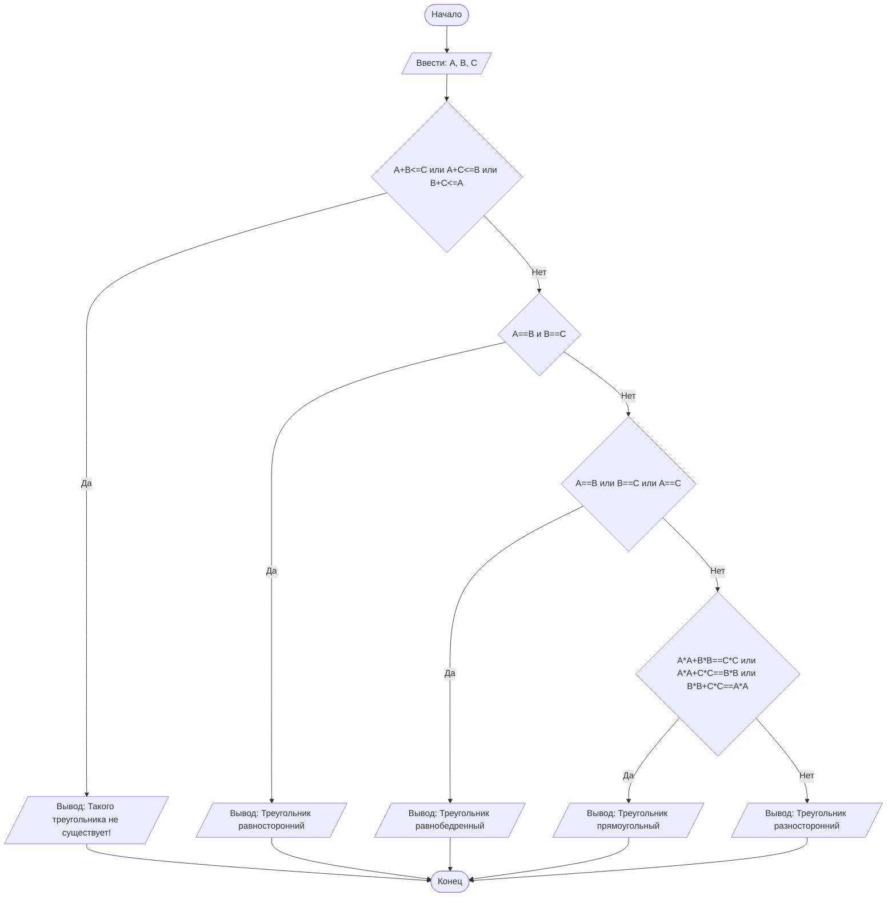

## Cодержание

1. [Отчет по лабораторной работе № N](#отчет-по-лабораторной-работе--n)
2. [Критерии оценивания](#критерии-оценивания)

# Отчет по лабораторной работе № N

#### № группы: `какая-то`

#### Выполнил: `Морозов Никита Евгеньевич`

#### Вариант: `10`

### Содержание:

*   Постановка задачи
*   Входные и выходные данные
*   Математическая модель
*   Выбор структуры данных
*   Алгоритм
*   Программа
*   Анализ правильности решения

### 1. Постановка задачи

*   **Условия задачи**
    > На вход программа получает три натуральных числа A, B и C. Эти числа обозначают длины трех отрезков. Необходимо определить, можно ли построить из этих отрезков треугольник. Если треугольник существует, определить и вывести его тип: равносторонний, равнобедренный, прямоугольный или разносторонний. В противном случае вывести сообщение о том, что треугольника не существует.

*   **Подробное описание**
    Программа должна считать три целых числа, представляющих длины сторон потенциального треугольника. Сначала проверяется фундаментальное геометрическое условие — неравенство треугольника. Если хотя бы одно из неравенств не выполняется, треугольник построить нельзя. Если треугольник существует, программа последовательно проверяет его свойства: равенство всех сторон, равенство двух сторон, наличие прямого угла (по теореме Пифагора). В зависимости от первого выполненного условия выводится соответствующий тип треугольника.

### 2. Входные и выходные данные

**Входные данные:**
На вход подаются три натуральных числа: A, B, C.
*   **Тип данных:** Целые числа.
*   **Количество:** 3 числа.
*   **Диапазон значений:** от 1 до 2 147 483 647.

| | Тип | min значение | max значение |
| :--- | :--- | :--- | :--- |
| **A (Число 1)** | Целое число | 1 | 2 147 483 647 |
| **B (Число 2)** | Целое число | 1 | 2 147 483 647 |
| **C (Число 3)** | Целое число | 1 | 2 147 483 647 |

**Выходные данные:**
*   **Тип данных:** Строка.
*   **Описание:** Одно из следующих сообщений:
    *   `"Такого треугольника не существует!"`
    *   `"Треугольник равносторонний"`
    *   `"Треугольник равнобедренный"`
    *   `"Треугольник прямоугольный"`
    *   `"Треугольник разносторонний"`

### 2,5. Математическая модель

Для решения задачи используются следующие математические положения:

1.  **Неравенство треугольника:** Треугольник существует тогда и только тогда, когда сумма длин любых двух его сторон строго больше длины третьей стороны:
    A + B > C
    A + C > B
    B + C > A
    Если хотя бы одно из этих условий нарушено, треугольник не существует.

2.  **Равносторонний треугольник:** Все три стороны равны: A = B = C.

3.  **Равнобедренный треугольник:** Две стороны равны: A = B или B = C или A = C.

4.  **Прямоугольный треугольник:** Выполняется теорема Пифагора: A² + B² = C² (или для любой другой пары катетов и гипотенузы).

5.  **Разносторонний треугольник:** Ни одно из вышеперечисленных условий не выполнено.

> **Важно:** При проверке неравенства треугольника для чисел, близких к максимуму типа `int` (2 147 483 647), возможно переполнение при сложении. Для надежной работы программы рекомендуется использовать 64-битный тип `long`.

### 3. Выбор структуры данных

Для хранения входных данных используются три переменные целочисленного типа `int`. Так как максимальное значение входных чисел равно 2 147 483 647 (максимум для `int`), для проверки условий существования треугольника и теоремы Пифагора желательно использовать тип `long` во избежание переполнения при сложении и возведении в квадрат. Однако в представленной реализации используется `int`, что является потенциальным источником ошибок на граничных значениях.

### 4. Алгоритм

1.  Начало.
2.  Считать три числа: A, B, C.
3.  Проверить неравенство треугольника: если `A + B <= C` **ИЛИ** `A + C <= B` **ИЛИ** `B + C <= A`, то:
    *   Вывести `"Такого треугольника не существует!"`.
    *   Перейти к шагу 8.
4.  Иначе проверить: если `A == B` **И** `B == C`, то:
    *   Вывести `"Треугольник равносторонний"`.
5.  Иначе проверить: если `A == B` **ИЛИ** `B == C` **ИЛИ** `A == C`, то:
    *   Вывести `"Треугольник равнобедренный"`.
6.  Иначе проверить теорему Пифагора: если `A*A + B*B == C*C` **ИЛИ** `A*A + C*C == B*B` **ИЛИ** `B*B + C*C == A*A`, то:
    *   Вывести `"Треугольник прямоугольный"`.
7.  Иначе:
    *   Вывести `"Треугольник разносторонний"`.
8.  Конец.

**Блок-схема (Mermaid):**



###5. Программа
```java
package com.itproger;

import java.util.Scanner;

public class Main {
    public static void main(String[] args) {
        Scanner input = new Scanner(System.in);
        
        // Считываем три стороны треугольника
        int a = input.nextInt();
        int b = input.nextInt();
        int c = input.nextInt();
        
        // Проверка неравенства треугольника
        if (a + b <= c || a + c <= b || b + c <= a) {
            System.out.println("Такого треугольника не существует!");
        } 
        // Проверка на равносторонний треугольник
        else if (a == b && b == c) {
            System.out.println("Треугольник равносторонний");
        } 
        // Проверка на равнобедренный треугольник
        else if (a == b || b == c || a == c) {
            System.out.println("Треугольник равнобедренный");
        } 
        // Проверка на прямоугольный треугольник (теорема Пифагора)
        else if (a * a + b * b == c * c || a * a + c * c == b * b || b * b + c * c == a * a) {
            System.out.println("Треугольник прямоугольный");
        } 
        // Если ни одно из условий не выполнено - треугольник разносторонний
        else {
            System.out.println("Треугольник разносторонний");
        }
        
        input.close();
    }
}
```
### 6. Анализ правильности решения

Приведены тесты, покрывающие все ветви алгоритма.

**1. Тест на несуществующий треугольник**
*   **Input:**
    ```
    1 2 5
    ```
*   **Output:**
    ```
    Такого треугольника не существует!
    ```
*   **Обоснование:** 1 + 2 = 3 < 5. Нарушено неравенство треугольника.

**2. Тест на равносторонний треугольник**
*   **Input:**
    ```
    5 5 5
    ```
*   **Output:**
    ```
    Треугольник равносторонний
    ```
*   **Обоснование:** Все стороны равны.

**3. Тест на равнобедренный треугольник**
*   **Input:**
    ```
    5 5 8
    ```
*   **Output:**
    ```
    Треугольник равнобедренный
    ```
*   **Обоснование:** Две стороны равны, треугольник существует (5 + 5 > 8).

**4. Тест на прямоугольный треугольник**
*   **Input:**
    ```
    3 4 5
    ```
*   **Output:**
    ```
    Треугольник прямоугольный
    ```
*   **Обоснование:** 3² + 4² = 9 + 16 = 25 = 5². Теорема Пифагора выполняется.

**5. Тест на разносторонний треугольник**
*   **Input:**
    ```
    4 5 6
    ```
*   **Output:**
    ```
    Треугольник разносторонний
    ```
*   **Обоснование:** Все стороны разные, теорема Пифагора не выполняется.

**6. Тест на граничные значения (потенциальное переполнение)**
*   **Input:**
    ```
    2147483647 2147483647 2147483647
    ```
*   **Output:**
    ```
    Треугольник равносторонний
    ```
*   **Обоснование:** Проверка на максимальных значениях. Обратите внимание: при таком вводе `a + b` переполняется, но поскольку `a == b == c`, то `a + b > c` будет истинно (из-за переполнения сумма станет отрицательной), и это может привести к неверному результату. **Рекомендуется заменить `int` на `long` для корректной работы на граничных значениях.**
